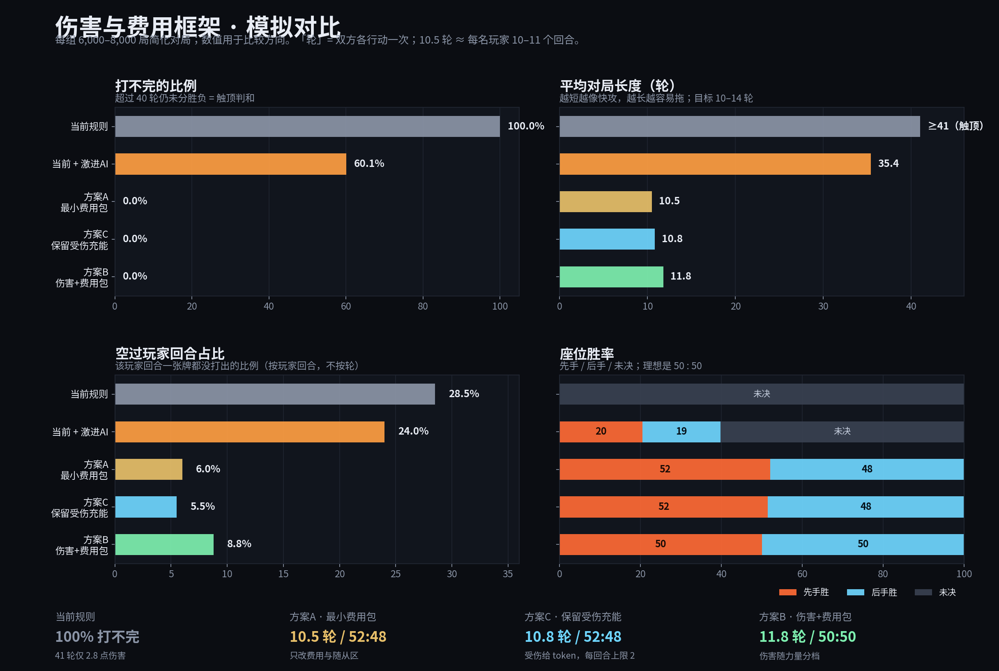

# 13. 伤害与费用框架诊断（建议稿）

> 性质：**玩法框架诊断**，不涉及代码实现。基于 `docs/06` 的现行规则 + `app/packages/core` 的实际实现，
> 外加一个简化对局模拟器做方向性验证。
>
> 结论先行：当前的问题不是「伤害太低」或「费用太高」这么简单，而是**伤害与费用各自缺一条腿，并且两个闭环互相拖后腿**：
>
> 1. **伤害**：伤害值与力量脱钩，指挥官 3 回合后变成 5 力墙 → 打不死；
> 2. **费用**：没有基础收入，充能是「2 张手牌换 1 张牌」 → 出不起、手牌卡死；
> 3. **受伤又给费用**：打人等于给对手送资源 → 进攻的收益被抵消。
>
> 三者叠加，模拟里**100% 的对局打不完**、**28.5% 的玩家回合一张牌都出不了**。

---

## 0. 先看一张图

> 每组 6,000–8,000 局简化对局；数值用于比较方向，不代表最终平衡。
> 「轮数」是**双方各行动一次 = 1 轮**，所以 10.5 轮 ≈ 每名玩家 10–11 个回合。

### 0.1 三套方案速览

| 方案 | 核心改动 | 打不完 | 平均轮数 | 先手/后手 | 适合 |
| --- | --- | --- | --- | --- | --- |
| **A 最小费用包** | 上限校验 + 每回合 1 费收入 + 4 格 | 0% | 10.5 | 52 / 48 | 想最小改动，保留平伤 |
| **C 保留受伤充能** | A + 受伤给 token（每回合上限 2） | 0% | 10.8 | 52 / 48 | 想保留「受伤 = 充能」的 flavor |
| **B 伤害 + 费用包** | A + 伤害按力量分档 + 18 血 + 受伤进墓地 + 后手 +1 牌 | 0% | 11.8 | 50 / 50 | 想让大怪真正终结、打脸有收益 |

---

## 1. 我怎么测的

### 1.1 两件事分开做

| 方法 | 做什么 | 能回答什么 |
| --- | --- | --- |
| **目测 / 规则推演** | 通读 `docs/06` A5/A9/A10、X-3/X-4，以及 `play.ts` / `attack.ts` / `charge.ts` | 规则之间是否自洽、有没有「写了但没跑」的条款 |
| **简化对局模拟** | 30 张随从、cost 0–7、power = cost+1、起手 5、抽 2、指挥官 0-1-3-5、3 格 | 对局长度、空过率、座位胜率、费用来源占比 |

### 1.2 模拟器的边界

- **只建模随从**：cost 0–7，power = cost + 1，damage 默认 1；不含卡牌效果、嘲讽、衍生物、法术（另有一个「6 张法术」变体）。
- **指挥官不能攻击**：攻击规则要求攻击方在 `board`，指挥官在 `commander` 区，所以它只挨打、不出手。
- **战斗纯力量比较**：大于杀、小于被反杀、等于同归于尽；攻击后休眠；无召唤失调（另有一个变体）。
- **AI 是启发式**：优先打脸 / 解场 / 充能；分「保守」与「激进」两套；另有「预读抽牌」的近似最优充能。
- **牌库空**：弃牌区洗回牌库，所以对局可以无限拖；模拟上限 40 回合，超过算「打不完」。

### 1.3 为什么用模拟而不是只凭手感

规则里有两处「反直觉的乘法」：充能是 2 换 1、受伤又送 1 张费。单看每一步都合理，
但叠在一起会指数级放大空过率。模拟能把这种「乘法效应」量化出来。

---

## 2. 现状：三组数字

| 指标 | 当前规则 | 当前 + 激进 AI | 说明 |
| --- | --- | --- | --- |
| **打不完（> 40 回合）** | **100.0%** | **60.1%** | 指挥官变 5 力墙后，双方都收不掉 |
| **平均对局长度** | **≥ 41 回合** | **35.4 回合** | 卡牌游戏常见 8–15 回合 |
| **空过玩家回合占比** | **28.5%** | **24.0%** | 超过四分之一玩家回合一张牌都没出 |
| **平均伤害** | **2.8** | **22.0** | 41 回合只打 2.8 血 |
| **5+ 费牌出场率** | 79.4% | 98.1% | 高费牌能出，但代价是大量空过 |
| **每轮平均充能** | 2.9 张 | 2.9 张 | 费用几乎全靠手牌/场面换 |
| **每轮平均出牌** | 1.65 张 | 1.77 张 | 每轮双方共抽 4 张，充能+出牌合计约 4.5 张，净手牌在缩 |

> 这组数字里最刺眼的是：**41 轮只造成 2.8 点伤害**。这不是「伤害低」，是**伤害窗口根本没打开**。

---

## 3. 伤害机制：四个具体问题

### 3.1 伤害值与力量脱钩 → 大怪不能终结

现状：

- 1 力随从打指挥官 = 1 点；7 力随从打指挥官 = 也是 1 点（卡面没写 `damage` 就默认 1，X-5）。
- 力量只决定「能不能站住 / 能不能打过对面随从」，**不决定打脸疼不疼**。
- 卡池里几乎没有 `damage > 1` 的卡，所以 `damage` 字段基本是装饰。

后果：

- 大怪是「解场工具」，不是「终结手段」；玩家没有抢血动机。
- 对局会自然滑向「谁先站住谁赢」的 board stall，而不是「谁先把对面打到 0」。
- 你给凤凰/凛冬之刃写的 `damage: 2` 是对的，但它是例外，不是规则。

> **设计判断**：如果力量承担「战斗裁决」，伤害承担「终结时钟」，那两者必须有稳定的换算关系；
> 否则玩家只需要看力量，`damage` 永远是一张卡一个价，无法形成系统。

### 3.2 指挥官 0-1-3-5 是主阀门，不是装饰

很多人会把指挥官曲线当成「成长感」，但在这套规则里它实际是**防御墙**：

- 指挥官不能攻击（`attack.ts` 只允许 `board` 单位发起攻击）；
- 它的力量只用于「被攻击时谁死」；
- 第 3 回合到 5 力后，只有 **6+ 力**随从能打穿它；卡池里 6+ 力的随从只有少数几张。

模拟验证（以下均为方案 A 的费用条件：1 费收入 + 4 格 + 平伤 1）：

| 指挥官曲线 | 平均轮数 | 先手胜率 | 结论 |
| --- | --- | --- | --- |
| **0-1-3-5（现行）** | ≥ 41 | — | 墙太高，打不完 |
| 0-1-3-4 | 7.5 | 65.9% | 墙一降，立刻变成快攻 |
| 0-1-2-4 | 7.0 | 65.5% | 同上 |
| 0-1-2-3 | 6.1 | 71.5% | 直接变成 6 回合赛跑 |

> **设计判断**：0-1-3-5 本身不是错，它是当前唯一有效的「防速攻阀门」。
> 但它的副作用是「第 3 回合后伤害窗口关闭」，而伤害又没有随力量成长，于是从「防速攻」变成「防一切」。
> **不建议直接降曲线**——一降就会变成 6–7 回合的先手赛跑（见上表）。
> 正确的做法是：**保留曲线，给伤害另一条成长轴**（见 §5 方案 B）。
>
> ⚠️ **前提待确认**：当前实现里指挥官**不能攻击**（攻击方必须在随从区）。
> 如果设计意图是「指挥官也能攻击」，那它会同时承担输出和防御，0-1-3-5 的意义会完全不同；
> 本文的所有结论都建立在「指挥官只挨打」这个现状上。

### 3.3 受伤给费用 → 打人 = 给对手送资源

现状（A5 补充 1）：指挥官每受 1 点伤害 → 从卡组顶展示 1 张 → 置入费用区。

模拟里的费用来源（方案 A，一局平均）：

| 来源 | 张数/局 | 占比 |
| --- | --- | --- |
| 充能 | 27.5 | 约 37% |
| 自动收入（方案 A 新增） | 20.5 | 27% |
| **受伤展示** | **27.2** | **36%** |

后果：

- 你打对手 1 点，对手多了 1 张资源；15 血 = 最多 15 张免费资源。
- 进攻方的伤害被防守方的资源抵消；越打，对手越富。
- 最优策略可能是「不主动进攻，等对手先打」——**机制在惩罚进攻**。
- 展示还会触发「展示时」效果（如斥候），等于受伤还可能触发对手的收益。

> **设计判断**：这不是说「受伤给费」一定错，它很有辨识度。但它必须是**有上限的、临时的、或不能转化为牌差的**，
> 否则「打脸」这件事在期望值上就是负收益。

### 3.4 15 血 + 默认 1 伤害 = 时钟太长

- 15 次成功打脸才赢；3 个随从全打脸也要 5 个战斗阶段。
- 实际随从会交换，指挥官力量会增长，成功打脸次数远低于 3/回合。
- 没有疲劳、没有 deck-out 伤害；牌库空了洗弃牌区，对局可以无限拖。

后果：

- 默认 1 伤害与 15 血不匹配；要么让伤害随力量成长，要么降血，要么给「穿透」。
- 没有防拖机制：一旦双方都收不掉，游戏可以永远打下去（模拟里 100% 触顶）。

---

## 4. 费用机制：五个具体问题

### 4.1 `maxCost` 根本没被校验

这是最硬的一条：

- `docs/06` A5-2 给了 1 → 3 → 5 → 10 的曲线；
- 但 `play.ts` 只检查「费用区张数 ≥ 卡面 cost」，**完全没有检查 `maxCost`**；
- 代码注释也承认：「最高费用的上限语义未定，本文件只按张数支付，不施加 maxCost 限制」。

后果：

- 1-3-5-10 目前只是状态值，没有 pacing 作用；
- 真正限制你的是「费用区有几张卡」，不是「你这回合应该有多少费」；
- 只要你能囤 10 张，第 1 回合也能拍 10 费（理论上）。

> **这是规则层的一处「写了但没跑」**。不管最后选哪套改法，这条都要先修。

### 4.2 没有基础收入 → 充能是唯一来源

现状：

- 开局费用区 0 张；
- 要出 1 费牌，得先从手牌充 1 张随从；
- 出 1 费牌 = 消耗 2 张手牌（1 张充能 + 1 张打出）；
- 从手牌充能时，出 C 费牌 = 消耗 **C + 1** 张手牌（C 张充能 + 1 张打出）。

抽 2/回合，所以可持续的出牌成本约 **1 费/回合**；3 费以上要靠「吃老本」或受伤。

模拟：

- 每轮平均充能 2.9 张、出牌 1.65 张；
- **28.5% 的玩家回合一张牌都没出**；
- 高费牌能出（5+ 费出场率 79%），但代价是前后大量空过。

> **设计判断**：这不是「玩家不会玩」，是**算术上就不可能每回合都出牌**。
> 一套 30 张的牌，抽 2 张/回合，每出一张要消耗 C+1 张，净手牌必然持续缩水。

### 4.3 费用区是「消耗品」，不是「资源基地」

- 支付的卡进墓地，下回合要从头充；
- 费用区不能沉淀，不能「越打越富」；
- 高费回合需要提前囤 5–10 张，极易被对手读穿/惩罚。

对比两种资源模型：

| 模型 | 充能是什么 | 高费牌体验 | 中后期 |
| --- | --- | --- | --- |
| **消耗品（现行）** | 一次性燃料 | 亏牌、卡手 | 每回合重新造资源 |
| **资源基地（横置/重置）** | 永久投资 | 可规划、可滚雪球 | 有成长感，但需要「破坏费用区」的互动 |

> 现行模型更像「弃牌换费」，不是「建设资源」。它让高费牌变成「手牌换场面」的亏牌牌，
> 而不是「前期投资、后期兑现」的后期牌。

### 4.4 随从区 3 格 + 只能在充能阶段充能 → 手牌卡死

- 3 格满了就不能再出随从；
- 充能只能在**充能阶段**（抽牌前）做，不能在主阶段把场上随从转成费用；
- 结果：手牌越积越多，空过回合增加。

模拟对照（方案 A 的其他条件相同，只改随从区）：

| 随从区 | 空过回合 | 先手/后手 | 平均轮数 |
| --- | --- | --- | --- |
| **3 格** | **17.1%** | **45.5 / 54.5** | 10.5 |
| **4 格** | **6.0%** | **52.1 / 47.9** | 10.5 |

> **设计判断**：3 格是隐藏的费用瓶颈。它不只是「场面小」，而是「手牌无法释放」。
> 如果不想改 B2 布局，替代方案是允许**主阶段把场上随从置入费用区**（牺牲/充能动作）。

### 4.5 法术不能被充能 → 法术卡组天然饿死

- 充能只允许随从（X-2 原文「任意数量的随从」）；
- 法术在手里既不能当资源，也不能站场；
- 结果：法术越多，费用越饿。

模拟（6 张法术，其余条件同当前规则）：

| 指标 | 数值 |
| --- | --- |
| 打不完 | 99.7% |
| 期末手牌 | 16.8 张 |
| 5+ 费牌出场率 | 24.1%（对比全随从 79.4%） |
| 平均伤害 | 1.6 |

> **设计判断**：法术不是「效果强弱」问题，是「资源循环」问题。
> 要么允许法术按 1 费充能，要么给法术一条独立的「仪式」支付线，否则法术卡组无法成立。

### 4.6 先手补偿是「双罚」，且 `maxCost` 按全局回合

现状：

- 先手第一回合抽 1 + 不能攻击；
- 后手第一回合抽 2 + 可攻击；
- `maxCostForTurn` 用**全局** `turn`：后手第一回合就是全局第 2 回合 → `maxCost = 3`；先手第一回合 = 1。

后果（一旦补上 `maxCost` 校验，这条会立刻生效）：

- 后手在费用曲线上领先一档（1 vs 3）；
- 在 3 格 + 平伤包里，后手胜率 54.5%（方案 A 的 3 格对照）；
- 先手补偿「双罚」在 4 格 + 平伤包里大致抵消（52/48），但在伤害包里又会变成先手 56–59%（不加后手补偿时）。

> **设计判断**：`maxCost` 必须按**各自回合数**推进，而不是全局 `turn`。
> 先手补偿不能既少抽又禁攻；建议「少抽 1」和「禁攻」二选一，另一个用后手资源/手牌补。

### 4.7 没有防拖机制

- 牌库空 → 弃牌区洗回，无疲劳、无 deck-out 伤害；
- 双方都收不掉时，游戏可以无限拖；
- 模拟里当前规则 100% 触顶。

> **设计判断**：即使修好伤害，也建议加一条「第 N 回合后进入骤死」或「牌库第二次洗回时指挥官每回合受 1 伤」的防拖规则。
> 否则「控制内战胜率 50% 但每局 40 分钟」会很难受。

---

## 5. 三个改法

> 下面三套都**保留**：指挥官 0-1-3-5 曲线、30+1 构筑、纯力量战斗、无随从生命值。
> 改动集中在「费用收入」和「伤害换算」。

### 方案 A：最小费用包（先让游戏能打完）

**改动**

1. **强制 `maxCost` 校验**：作为「每回合可消耗的费用张数上限」，按**各自回合数**推进。
   （模拟里「全局 / 各自回合」结果相同，因为费用区张数才是实际瓶颈；但规则上应按各自回合，避免后手白拿一档。）
2. **每回合充能阶段自动 1 张卡进费用区**（基础收入）。
3. **随从区 3 → 4**。
4. 伤害 / 血量 / 受伤给费全部不动。

**模拟结果**

| 指标 | 数值 |
| --- | --- |
| 打不完 | **0%** |
| 平均轮数 | **10.5**（每名玩家 10–11 个回合） |
| 空过回合 | **6.0%** |
| 先手/后手 | **52.1 / 47.9** |
| 平均伤害 | 27.2 |
| 5+ 费出场率 | 100% |

**适合**：想最小改动、保留「伤害区 = 费用区」的原味。

**风险**：大怪仍然不能终结；受伤送费仍在（27.2 张/局）；只是靠 4 格和收入把节奏拉回来。

---

### 方案 C：保留受伤充能，但把「送牌」改成「送 token」

**改动**（在方案 A 基础上）

- 受伤不再从卡组顶展示牌进费用区，而是给**费用 token**；
- 每回合最多给 **2 个** token；
- token 花掉即消失，不进牌库/墓地；
- 平伤 1、15 血不变。

**模拟结果**

| 指标 | 数值 |
| --- | --- |
| 打不完 | **0%** |
| 平均轮数 | **10.8** |
| 空过回合 | **5.5%** |
| 先手/后手 | **51.5 / 48.5** |

**token 上限的敏感性（重要）**

| 每回合 token 上限 | 平均轮数 | 先手胜率 | 结论 |
| --- | --- | --- | --- |
| 1 | 13.0 | **59.2%** | 资源不够，先手滚雪球 |
| **2** | **10.8** | **51.5%** | 最平衡 |
| 无上限 | 5.9 | **87.5%** | 直接爆炸 |

**适合**：喜欢「受伤 = 充能」的 flavor，但不想让对手靠受伤白赚牌。

**风险**：token 上限必须调；上限 1 会先手过强，上限 2 才平衡。

---

### 方案 B：伤害 + 费用一起改（推荐，游戏感最好）

**改动**（在方案 A 基础上）

1. **伤害随力量分档**：
   - 1–3 力 → 1 点
   - 4–6 力 → 2 点
   - 7+ 力 → 3 点
2. **指挥官 15 → 18 血**。
3. **受伤不再给费用**：展示 1 张进墓地（或除外），不进费用区。
4. **后手起手 +1 张**（补偿先手节奏）。

**模拟结果**

| 指标 | 数值 |
| --- | --- |
| 打不完 | **0%** |
| 平均轮数 | **11.8** |
| 空过回合 | **8.8%** |
| 先手/后手 | **50.0 / 50.0** |
| 平均伤害 | 31.4 |
| 5+ 费出场率 | 100% |

**血量档位**

| 血量 | 平均轮数 | 先手/后手 |
| --- | --- | --- |
| 16 | 10.2 | 52.0 / 48.0 |
| **18** | **11.8** | **50.0 / 50.0** |
| 20 | 13.3 | 49.3 / 50.7 |

**适合**：想让大怪真正终结、想让「打脸」有收益、想拉长到 10–14 回合。

**风险**：改动最大；失去「伤害区 = 费用区」的 flavor；需要重新调 HP、分档、后手补偿。

---

### 5.4 三套对比

| 维度 | 当前 | 方案 A | 方案 C | 方案 B |
| --- | --- | --- | --- | --- |
| 打不完 | **100%** | 0% | 0% | 0% |
| 平均轮数 | ≥41 | 10.5 | 10.8 | 11.8 |
| 空过回合 | 28.5% | 6.0% | 5.5% | 8.8% |
| 先手/后手 | — | 52/48 | 52/48 | 50/50 |
| 大怪能终结 | 否 | 否 | 否 | **是** |
| 受伤送费 | 送牌 | 送牌 | token 上限 2 | 不送 |
| 改动量 | — | **小** | 中 | 大 |
| 推荐顺序 | — | **第一步** | 可选 | **最终形态** |

---

## 6. 推荐落地顺序

| 优先级 | 改动 | 理由 |
| --- | --- | --- |
| **P0** | 强制 `maxCost` 校验，按**各自回合数**推进 | 现在这条规则没跑；不修的话任何费用曲线都是装饰 |
| **P0** | 每回合充能阶段自动 1 张进费用区 | 没有基础收入，C 费牌 = C+1 张手牌，算术上不可持续 |
| **P1** | 随从区 3 → 4（或加「主阶段牺牲/充能」） | 3 格让空过率 17.1%，4 格降到 6.0% |
| **P1** | 允许法术按 1 费充能（或给法术独立支付线） | 法术卡组现在天然饿死 |
| **P1/P2** | 先上方案 A 或 C 跑一周，再决定是否上方案 B | A/C 改动小，能先验证「收入 + 4 格」是否解决体感 |
| **P2** | 若上方案 B：伤害分档 + 18 血 + 受伤进墓地 + 后手 +1 牌 | 三件套要一起调，单改一件会偏 |
| **P2** | 加防拖规则（骤死 / 第二次洗回后每回合 1 伤） | 即使修好伤害，控制内战仍可能拖长 |

---

## 7. 不建议的做法

| 做法 | 模拟结果 | 为什么不要 |
| --- | --- | --- |
| 只把伤害从 1 改成 2/3，不动费用和血量 | 分档 + 15 血 = 9.5 回合，52.0/47.9 | 变快，但先手仍占优；血量才是调平衡的主旋钮 |
| 受伤给 token 且不设上限 | **5.9 回合，先手 87.5%** | 资源爆炸，直接变成先手赛跑 |
| 用 1-2-4-6-8-10 曲线 | **先手 70.6%** | 曲线越平滑，先手的节奏优势越明显（至少在当前全局 turn 口径下） |
| 抽 1 + 每回合收入 1 | **空过 21.2%，先手 61.8%** | 抽 2 是必要的；收入不能替代抽牌 |
| 每回合自动收入 2 | **7.4 回合，先手 77.1%** | 收入 1 足够，2 就太快 |
| 直接把指挥官曲线降到 0-1-2-3 | **6.1 回合，先手 71.5%** | 5 力墙是当前唯一有效的防速攻阀门；降了会变成赛跑 |
| 给随从加生命值 | — | 这是另一套战斗框架，会推翻 X-3 的纯力量裁决和现有卡牌；先用「伤害分档 / 穿透」解决终结问题 |

---

## 8. 两个更彻底的方向（可选，不是第一步）

### 8.1 费用区变「资源基地」：横置 / 重置

- 充能进费用区的卡**不消耗**；支付时横置，充能阶段重置；
- `maxCost` 限制每回合可横置的张数；
- 充能是**永久投资**，不是一次性燃料。

**优点**：中后期有成长感；高费牌可规划；充能不再是亏牌。
**缺点**：费用区单调增长，需要「破坏费用区」的互动；受伤给费会变成永久加速，必须改成 token 或取消。

### 8.2 战斗加「穿透」（overkill）

- 攻击随从时，若攻击方力量 > 防守方，**溢出部分对指挥官造成伤害**（或转化为伤害值）；
- 不需要给随从加血，保留纯力量裁决；
- 大怪能终结，且鼓励用大怪进攻而不是互相交换。

**优点**：解决「大怪不能终结」；不需要推翻 X-3。
**缺点**：可能让大雪球更快；需要定义溢出是否受伤害值/分档影响。

---

## 9. 一句话总结

当前不是「伤害太低」或「费用太高」，而是**伤害与费用两个闭环各自缺一条腿**：

- 伤害缺「随力量成长」→ 大怪不能终结；
- 费用缺「基础收入」→ 高费牌出不起；
- 受伤送费又把两者绑成一个**惩罚进攻**的循环。

**先修 `maxCost` + 基础收入 + 4 格**，能让游戏从「100% 打不完」变成「能打完」；
**再决定要不要上伤害分档**，让大怪真正成为终结者。

---

## 附录 A：关键模拟数据

| 变体 | 打不完 | 平均轮数 | 空过 | 先手/后手 | 平均伤害 |
| --- | --- | --- | --- | --- | --- |
| 当前规则 | 100.0% | ≥41 | 28.5% | — | 2.8 |
| 当前 + 激进 AI | 60.1% | 35.4 | 24.0% | 20.5 / 19.3 | 22.0 |
| **方案 A** | **0%** | **10.5** | **6.0%** | **52.1 / 47.9** | 27.2 |
| **方案 C** | **0%** | **10.8** | **5.5%** | **51.5 / 48.5** | 27.0 |
| **方案 B（18 血）** | **0%** | **11.8** | **8.8%** | **50.0 / 50.0** | 31.4 |
| 方案 B（16 血） | 0% | 10.2 | 16.4% | 52.0 / 48.0 | 28.1 |
| 方案 B（20 血） | 0% | 13.3 | 17.9% | 49.3 / 50.7 | 34.8 |
| 方案 A（3 格对照） | 0% | 10.5 | 17.1% | 45.5 / 54.5 | 26.9 |
| 方案 A + 6 法术可充能 | 0.1% | 13.2 | 16.3% | 55.4 / 44.5 | 26.5 |
| 方案 A + 召唤失调 | 1.9% | 19.5 | 22.6% | 50.0 / 48.1 | 25.4 |

## 附录 B：模拟器的已知偏差

1. **AI 不是最优解**：它不会做复杂的跨回合规划、不会保留特定牌、不会读对手手牌；因此「空过率」可能高估，但「算术上不可持续」这个结论不受影响。
2. **没有卡牌效果**：真实卡牌效果会改变费用/伤害曲线；本报告只诊断框架，不等于最终平衡。
3. **没有嘲讽**：嘲讽会让快攻更难过墙，可能让方案 B 的斩杀更慢。
4. **没有法术**：法术的效果会提供额外的资源/伤害；本报告只用一个「6 张死法术」变体说明资源端的下限。
5. **对局上限 40 回合**：超过算「打不完」，真实规则没有上限，所以当前规则的「无限拖」只会更严重。
