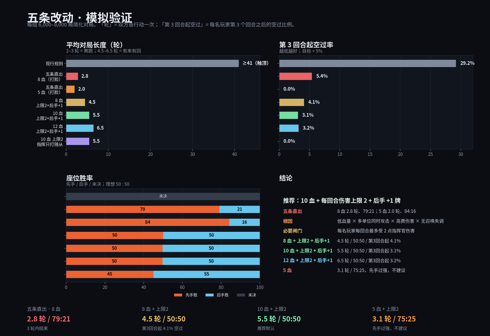

# 14. 五条改动的模拟验证（建议稿）

> 输入：Era 2026-10-19 五条拍板
>
> 1. 指挥官能攻击；
> 2. 高费大怪伤害提升；
> 3. 每回合从卡组顶充能 2 张；
> 4. 总血量降到 5 或 8；
> 5. 降低空过率，至少 2 回合后尽量不要空过。
>
> **结论先行**：这五条**直接叠加**会得到 **2–3 轮结束、先手 76–100%** 的赛跑，不是「更快但有来有回」。
> 原因是「低血量 + 多单位同时攻击 + 高费伤害 + 无召唤失调」四件事叠在一起，伤害远超血量。
>
> 要保留 8 血，必须再加一个**每回合对指挥官伤害上限 2** 的闸门。加上之后：
>
> | 血量 | 平均轮数 | 先手/后手 | 空过 | 第 3 回合起空过 |
> | --- | --- | --- | --- | --- |
> | **8** | 4.5 | **50.1 / 49.9** | 4.5% | 4.1% |
> | **10（推荐）** | 5.5 | **49.8 / 50.2** | 3.8% | 3.1% |
> | **12** | 6.5 | **49.8 / 50.2** | 3.7% | 3.2% |
>
> 5 血即使加上限也还是 3.1 轮、**75.4 / 24.6**（先手过强）；**不建议**。
>
> 表中 8 / 10 / 12 血均含「后手起手 +1 牌」；不含这项补偿时，8 血先手 56.5%、10 血 57.8%。

---

## 0. 口径

| 术语 | 定义 |
| --- | --- |
| **1 轮** | 双方各行动一次（先手一个回合 + 后手一个回合） |
| **空过** | 该玩家回合**没有打出任何牌**（指挥官攻击不算“出牌”） |
| **第 3 回合起空过** | 每名玩家第 3 个回合之后，空过回合占其回合数的比例 |
| **伤害上限** | 每名玩家**每回合**最多受到的指挥官伤害；超出部分不结算 |

模拟条件：30 张随从、cost 0–7、power = cost + 1、起手 5、每回合抽 2、4 格随从区、
指挥官 0-1-3-5、收入 2、无卡牌效果/嘲讽/法术；每组 6,000–8,000 局；简化 AI，数值只用于比较方向。

---

## 1. 直接跑五条：2–3 轮结束

| 组合（5/8 血 + 收入 2 + 指挥官攻击 + 高费伤害） | 平均轮数 | 先手 / 后手 | 第 3 回合起空过 |
| --- | --- | --- | --- |
| 5 血，指挥官打脸 | **2.0** | **84.2 / 15.8** | 0.0% |
| 8 血，指挥官打脸 | **2.8** | **79.1 / 20.9** | 5.4% |
| 5 血，指挥官都可（打脸/随从） | 2.0 | 80.9 / 19.1 | 0.0% |
| 8 血，指挥官打随从 | 3.1 | **95.4 / 4.6** | 0.0% |

> 空过率看起来很低，但这是因为**对局在 2–3 轮就结束了**，不是「每回合都有牌出」。
> 第 3 回合起空过 0% 的几组，往往是因为第 3 回合已经打完了。

---

## 2. 为什么会变成赛跑

### 2.1 低血量放大了「多单位同时攻击」

- 8 血时，3 个 2–3 伤的单位一回合就能打 6–9 点；伤害上限不存在。
- 没有召唤失调：当回合出的随从当回合就能攻击，第 2 轮就能爆发。
- 4 格随从区进一步放大：一回合能铺 3–4 个攻击源。

### 2.2 指挥官攻击又加了一个攻击源

- 指挥官每回合可以攻击一次，等于每个玩家多了一个 1–3 伤的来源。
- 指挥官按**各自回合**成长：先手第 2 个回合到 3 力，后手还在 1 力；先手有一个「3 力打 1 力」的窗口。
- 如果指挥官只打随从，它不直接打脸，但仍然每回合白吃一个低力随从，节奏更快。

### 2.3 先手惩罚在短局里太重

- 先手第一回合抽 1 + 不能攻击；后手抽 2 + 可攻击。
- 2–3 轮的局里，后手「先攻击」的优势被放大；先手的补偿又不够，导致胜率在 30/70 到 95/5 之间剧烈摆动。
- 这不是「平衡问题」，是**对局太短，先手/后手的第一个动作就决定胜负**。

---

## 3. 加一个闸门：每回合伤害上限 2

这是让 8 血成立的关键。它不是「护甲」，不阻止随从被破坏，只限制**对指挥官的爆发**：

> 每名玩家每回合最多受到 **2 点**指挥官伤害；超出部分不结算。

加上后（8/10/12 血都带「后手 +1 牌」）：

| 血量 | 平均轮数 | 先手 / 后手 | 空过 | 第 3 回合起空过 |
| --- | --- | --- | --- | --- |
| **8** | **4.5** | **50.1 / 49.9** | 4.5% | 4.1% |
| **10（推荐）** | **5.5** | **49.8 / 50.2** | 3.8% | 3.1% |
| **12** | **6.5** | **49.8 / 50.2** | 3.7% | 3.2% |
| 5 | 3.1 | **75.4 / 24.6** | 4.8% | 3.9% |

> 后手 +1 牌很关键：不加的话，8 血是 56.5 / 43.5，10 血是 57.8 / 42.2，先手仍偏强。

**为什么 5 血不行**：3.1 轮结束，每名玩家只有 3 个回合；先手胜率 **75.4%**。
5 血不是「更快」，是「先手更容易赢」。

---

## 4. 推荐方案

### 4.1 8 血版（快攻版）

| 项 | 值 |
| --- | --- |
| 血量 | 8 |
| 收入 | 每回合充能阶段从卡组顶 2 张进费用区 |
| 伤害上限 | 每名玩家每回合最多受 2 点 |
| 高费伤害 | 1–3 力→1；4–6 力→2；7+ 力→3（受上限截断） |
| 指挥官 | 可攻击；每回合一次；可打脸或打随从 |
| 随从区 | 4 格 |
| 先手补偿 | 先手第一回合抽 1 + 不能攻击；**后手起手 +1 牌** |
| 结果 | **4.5 轮，50.1/49.9，空过 4.5%，第 3 回合起 4.1%** |

- 每名玩家约 4–5 个回合，30 张牌用掉约一半；
- 适合「10 分钟内一局」的快攻版本。

### 4.2 10 血版（推荐）

同上，血量 10。

- **5.5 轮，49.8/50.2，空过 3.8%，第 3 回合起 3.1%**；
- 每名玩家约 5–6 个回合，有更多决策空间；
- 推荐作为默认版本。

### 4.3 12 血版（更稳）

- **6.5 轮，49.8/50.2，空过 3.7%，第 3 回合起 3.2%**；
- 如果实测觉得 10 血还是太快，用 12。

### 4.4 不推荐 5 血

- 3.1 轮，**75.4 / 24.6**，第 3 回合起 3.9% 空过；
- 空过率虽然低，但先手胜率过高：每名玩家只有 3 个回合，先手/后手与抽牌波动决定胜负。

---

## 5. 规则文本建议

### 5.1 指挥官攻击

- 每回合一次，指挥官可以攻击**敌方指挥官**或**敌方随从**。
- **攻击随从**：比较力量；指挥官力量 > 目标，目标破坏；否则指挥官受到 1 点伤害（指挥官不破坏，也不掉到 0 以下）。
- **攻击敌方指挥官**：比较力量；攻击方 > 防守方，防守方受到伤害；攻击方 < 防守方，攻击方受到伤害；相等，双方各受 1 点伤害。
- 指挥官的攻击不消耗“休眠”状态（它不在随从区），但每回合只能一次。
- **建议**：如果保留打脸，配合「每回合伤害上限 2」；如果觉得打脸太凶，改成「指挥官只能打随从」，用随从作为主要输出。

### 5.2 伤害上限

- 每名玩家每回合最多受到 **2 点**指挥官伤害；超出部分不结算。
- 这个上限只作用于**指挥官**，不影响随从之间的战斗（随从仍然按力量比较破坏）。
- 与高费伤害的交互：7+ 力随从的 3 点伤害，在“本回合已受伤 2 点”时会被截断；它仍然是最强的战斗单位（一击打满上限、力量高、能站住），只是不能一回合叠死。

### 5.3 费用

- 充能阶段开始时，从卡组顶将 **2 张**卡置入费用区。
- 保留「可将手牌/场上随从充能」作为额外收入。
- `maxCost` 按**各自回合**校验（1-3-5-10），作为每回合可消耗张数上限；不按全局回合，避免后手白拿一档。

### 5.4 先手补偿

- 先手第一回合抽 1、不能攻击（现行）。
- **后手起手 +1 张（6 张）**。模拟里这是把 8/10/12 血拉回 50/50 的关键；不加的话先手 56–58%。

---

## 6. 高费伤害的取舍

| 方案 | 7+ 力伤害 | 体感 | 风险 |
| --- | --- | --- | --- |
| **tier2 + 上限 2（推荐）** | 3（受上限截断） | 大怪是「一击打满上限」的威胁，不能叠死 | 大怪的 3 点只有在“本回合未受伤”时打满 |
| tier2 + 上限 3 | 3 | 大怪能稳定打 3 | 模拟里座位胜率在 21/79 到 99/1 之间剧烈摆动，不建议 |
| tier3 + 上限 2 | 4（截断） | 大怪更凶 | 8 血 5.1 轮、先手 85%，太快 |

> 结论：**上限 2 + tier2** 是最稳的组合。高费大怪仍然是最强的战斗单位（力量高、能站住、能一击打满上限），
> 只是不能一回合叠死。这是「低血量」必须付的代价。

---

## 7. 下一步

1. 在 8 / 10 / 12 里选一个作为默认；建议 **10**。
2. 写进正式规则（A5 费用、A10 初始配置、X-* 指挥官攻击、X-* 伤害上限）。
3. 人工跑 20 局，重点看：
   - 每回合伤害上限 2 是否让「大怪」感觉不够爽；
   - 指挥官攻击随从是否太强（5 力指挥官每回合白吃一个 4 力）；
   - 4 格随从区是否让 UI 太挤；
   - 后手 +1 牌是否足够/过头；
   - 收入 2 是否让牌库消耗太快（30 张约 8 轮见底）。
4. 如果人工测试觉得「8 血太短」，**优先升 10**，不要降伤害上限；降上限会让大怪更没意义。

---

## 附录：关键数据

| 变体 | 轮数 | 先手/后手 | 第 3 回合起空过 |
| --- | --- | --- | --- |
| 5 血，收入 2，指挥打脸，无上限 | 2.0 | 84.2 / 15.8 | 0.0% |
| 8 血，收入 2，指挥打脸，无上限 | 2.8 | 79.1 / 20.9 | 5.4% |
| 8 血，收入 2，指挥打随从，无上限 | 3.1 | 95.4 / 4.6 | 0.0% |
| **8 血，上限 2，指挥都可，后手 +1** | **4.5** | **50.1 / 49.9** | **4.1%** |
| **10 血，上限 2，指挥都可，后手 +1** | **5.5** | **49.8 / 50.2** | **3.1%** |
| **12 血，上限 2，指挥都可，后手 +1** | **6.5** | **49.8 / 50.2** | **3.2%** |
| 5 血，上限 2，指挥都可，后手 +1 | 3.1 | 75.4 / 24.6 | 3.9% |
| 10 血，上限 2，指挥打随从 | 5.5 | 45.1 / 54.9 | **0.0%** |
| 10 血，上限 3，指挥都可，后手 +1 | 4.2 | 21.1 / 78.8 | 8.2% |
| 12 血，上限 3，指挥都可，后手 +1 | 5.0 | 99.0 / 1.0 | 1.3% |
| 8 血，上限 2，无指挥官攻击，后手 +1 | 4.5 | 47.9 / 52.1 | 8.4% |

> 说明：表中「空过」按**玩家回合**统计；「轮数」是双方各行动一次的轮数。
> 简化模拟不含卡牌效果、嘲讽、法术，数值用于比较方向，不是最终平衡。
