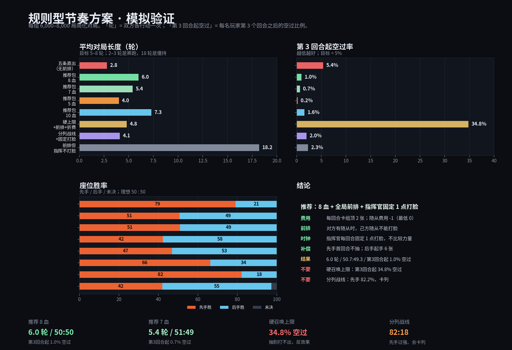

# 15. 规则型节奏方案：前排 + 指挥官时钟 + 费用折减（建议稿）

> **状态：血量已定为 8。** 可直接实现的逐条规则见 `16-核心规则条文-8血版.md`；
> 本文保留推导过程与对比数据。
>
> 输入：Era 2026-10-19 三条新方向
>
> 1. **不要限制每回合伤害**，从规则和数值下手；
> 2. 每回合可召唤的随从力量值按指挥官力量限制，多回合后解除；取消/降低一部分召唤费用，费用换身材或效果；
> 3. 或者：随从不能直接攻击对方指挥官，只能优先攻击当前格子前方的随从。
>
> **结论先行**：第 3 条（前排）是这三条里最有效的节奏阀；但**不需要做成“分列战线”**，用更简单的
> **全局前排**（对方有随从时，己方随从不能打脸）就能达到同样目的，而且不会卡列。
>
> 再配一个**指挥官固定 1 点打脸时钟**，游戏就能在不加伤害上限的前提下稳定收尾。
>
> 推荐组合（8 血）：
>
> | 指标 | 数值 |
> | --- | --- |
> | 平均轮数 | **6.0** |
> | 先手 / 后手 | **50.7 / 49.3** |
> | 空过（玩家回合） | **1.5%** |
> | 第 3 回合起空过 | **1.0%** |
> | 打不完 | **0%** |
>
> 7 血版本：5.4 轮、51.0/49.0、第 3 回合起 0.7%；5 血版本：4.0 轮、42.3/57.7、0.2%（后手偏强）。

---

## 0. 口径

- **1 轮** = 双方各行动一次；**空过** = 该玩家回合没有打出任何牌。
- 模拟：30 张随从、cost 0–7、power = cost+1、起手 5、每回合抽 2（先手首回合按变体调整）、
  收入 2、3 格、指挥官 0-1-3-5、高费伤害分档（1–3→1，4–6→2，7+→3）、无伤害上限。
- 每组 6,000–8,000 局；简化 AI；数值用于比较方向。

---

## 1. 三条方向分别跑出来是什么

| 变体 | 轮数 | 先手/后手 | 第 3 回合起空过 | 结论 |
| --- | --- | --- | --- | --- |
| 五条直出（无前排、无上限） | 2.8 | 79.1 / 20.9 | 5.4% | 2–3 轮赛跑 |
| **全局前排 + 指挥官固定打脸** | **6.0** | **50.7 / 49.3** | **1.0%** | **推荐** |
| 分列战线 + 指挥官固定打脸 | 4.1 | 82.2 / 17.8 | 2.0% | 卡列、先手过强 |
| 硬召唤上限 + 前排 + 固定打脸 | 4.8 | 66.3 / 33.7 | **34.8%** | 大量牌抽到打不出 |
| 只折费、无前排 | 2.0 | 0 / 100 | 0.0% | 后手直接打穿 |
| 前排 + 固定打脸，不折费 | 5.6 | 65.0 / 35.0 | 0.4% | 先手偏强、空过略高 |

### 1.1 关键结论

- **前排是有效的**：把“随从直接打脸”关掉，2–3 轮的赛跑立刻变成 6 轮左右的中盘。
- **必须给一个稳定时钟**：如果随从不能打脸、指挥官也不打脸，游戏会拖到 18–20 轮（见 §3）。
  指挥官每回合固定 1 点打脸，是最干净的时钟。
- **硬召唤上限反而是空过头号杀手**：它让你抽到高力量随从却打不出，空过率从 1.5% 涨到 34.8%。
  这是“规则限制”与“降低空过”直接冲突的地方。
- **分列战线不如全局前排**：分列会卡列（前面站着一个打不过的随从，后面的大哥进不来），
  先手 82.2%；要做分列，必须再加“替换/破列”规则。

---

## 2. 推荐组合（8 血）

| 项 | 规则 |
| --- | --- |
| 血量 | **8**（已定；7 血 5.4 轮、5 血 4.0 轮可作备选） |
| 费用收入 | 每回合充能阶段从卡组顶 **2 张**进费用区 |
| 召唤费用 | 所有随从 **-1 费**（最低 0）；高力量随从用卡面费用/效果体现“费用换身材/效果” ⚠️ **已作废**（D-313 / #164）：这 1 费已烘焙进 24 张随从的卡面 `cost`，不再有运行时全局减费。方案意图（随从便宜一档）仍成立，只是不再靠一条规则实现 |
| 前排 | **对方随从区有随从时，己方随从不能攻击对方指挥官，必须攻击随从；对方随从区为空时才能打脸** |
| 指挥官 | 每个己方战斗阶段一次，**固定对敌方指挥官造成 1 点伤害**（不比较力量）；指挥官不受前排限制 |
| 伤害上限 | **不设** |
| 高费伤害 | 1–3 力→1；4–6 力→2；7+ 力→3（只在该随从能打脸时生效） |
| 随从区 | 3 格 |
| 先手补偿 | **先手第一回合不抽牌**（起手 5 张）；**后手起手 6 张** |

**模拟结果**：6.0 轮、50.7/49.3、空过 1.5%、第 3 回合起 1.0%、打不完 0%。

### 2.1 为什么是“全局前排”而不是“分列战线”

| 规则 | 轮数 | 先手/后手 | 第 3 回合起空过 | 问题 |
| --- | --- | --- | --- | --- |
| **全局前排** | **6.0** | **50.7 / 49.3** | **1.0%** | 无 |
| 分列战线（3 列） | 4.1 | 82.2 / 17.8 | 2.0% | 打不过的前排会永久卡住这一列；先手先铺，优势过大 |

分列战线要成立，至少还要补一条“替换/破列”规则：

- 召唤到已占用的格子时，把原随从置入弃牌区（用一张牌换列）；
- 或指挥官可以攻击任意列的随从（破列）。

这两条都会增加复杂度；而**全局前排**已经能实现“随从不能越过场面直接打脸”的战术目的，推荐先用它。

---

## 3. 为什么需要“指挥官固定打脸”

如果只做前排、指挥官也不打脸，双方会进入纯场面僵持：

| 变体 | 轮数 | 先手/后手 | 打不完 | 说明 |
| --- | --- | --- | --- | --- |
| 前排，指挥官不打脸 | 18.2 | 42.0 / 55.2 | 2.8% | 谁也不敢先破场面，拖到 18 轮 |
| 前排 + 指挥官固定 1 点 | **6.0** | **50.7 / 49.3** | **0%** | 稳定时钟，场面决定谁扛得住 |

**规则文本**：

> 每个己方战斗阶段一次，指挥官可以对敌方指挥官造成 **1 点伤害**。
> 这次攻击**不比较力量**，也不受“前排”限制。

指挥官的 0-1-3-5 力量曲线仍然保留，但它现在主要决定**召唤上限/破列能力**（如果启用），
而不是决定打脸伤害。这样“指挥官成长”不会变成“打脸越来越疼”的雪球。

---

## 4. 召唤力量上限：为什么这版不建议用“硬上限”

你的第 2 条是“每回合可召唤的随从力量值按指挥官力量限制，多回合后解除”。我测了三种做法：

| 做法 | 轮数 | 先手/后手 | 第 3 回合起空过 | 结论 |
| --- | --- | --- | --- | --- |
| **硬上限**（力量 ≤ 指挥官力量；4 回合解除） | 4.8 | 66.3 / 33.7 | **34.8%** | 抽到高力量随从打不出，空过爆炸 |
| 硬上限（按各自指挥官力量） | 5.2 | **91.6 / 8.4** | 0.8% | 先手先解锁，后手被锁死 |
| **软上限**（超出部分每点 +1 费；4 回合解除） | 6.0 | 50.7 / 49.3 | 1.0% | 与“不加上限”完全一致；可保留 flavor |

**结论**：

- **硬上限与“降低空过”直接冲突**。它把“抽到高费牌打不出”从偶发变成常态。
- 如果按**各自指挥官力量**算上限，先手会先解锁高力量随从，后手被锁死（91.6/8.4）。
  必须改成**双方同步的轮次力量**，才可能公平。
- 如果喜欢“力量限制”的 flavor，用**软上限**：力量超过指挥官当前力量的随从，每超 1 点召唤费 +1；
  4 回合后解除。这样你仍然“可以用大怪”，只是要付溢价，不会空过。
- **“费用换身材/效果”更适合落在卡面费用上**：低力量随从费用 -1 / 0，高力量随从费用高、
  或带效果。不要用一个全局硬上限去卡所有召唤。

---

## 5. 先手补偿：为什么是“先手不抽 + 后手 +1 张”

| 补偿 | 轮数 | 先手/后手 | 第 3 回合起空过 |
| --- | --- | --- | --- |
| 只先手首回合抽 0 | 6.0 | 62.0 / 38.0 | 0.9% |
| 只后手 +1 牌 | 6.1 | 65.0 / 35.0 | 0.8% |
| **先手抽 0 + 后手 +1 牌** | **6.0** | **50.7 / 49.3** | **1.0%** |
| 先手抽 1 + 后手 +1 牌（现行抽牌） | 6.1 | 65.0 / 35.0 | 0.8% |

单做一项都不够；两项一起，才把 65/35 拉回 50/50。原因是这套规则下**先手的第一个随从**很值钱：
先手先铺，后手必须用额外的牌去解；所以补偿必须同时给“后手多一张牌”和“先手少抽一张”。

⚠️ **补偿值会随卡组构成变化**。上表是 30 张全随从的卡组。如果卡组是 23 随从 + 7 法术，
且法术没有实际效果，实测后手会涨到 **60.2%**——法术变成死牌，先手“不抽牌”的代价被放大。
所以法术必须有可结算的效果；法术强度不足时，把后手起手从 6 降到 5（双方都 5 张，先手仍不抽）。

**规则文本**：

> 先手第一回合的抽牌阶段**不抽牌**（起手 5 张）；后手起手 **6 张**。
> 双方血量相同（8 / 7 / 5）。

---

## 6. 血量档位

| 血量 | 轮数 | 先手/后手 | 第 3 回合起空过 | 评价 |
| --- | --- | --- | --- | --- |
| **5** | 4.0 | 42.3 / 57.7 | 0.2% | 很快；后手偏强，需再调补偿 |
| **7** | 5.4 | 51.0 / 49.0 | 0.7% | 快而稳 |
| **8（已定）** | 6.0 | 50.7 / 49.3 | 1.0% | 已选定 |
| 10 | 7.3 | 46.9 / 53.1 | 1.6% | 更长，后手略强 |

- 你原来想试 5 或 8：**8 血最稳**；5 血也能玩（4 轮），但后手 57.7%，需要把先手补偿再调轻一点。
- 如果实测觉得 8 血还是太长，降到 **7** 是最平滑的中间档。

---

## 7. 落地顺序

| 优先级 | 改动 | 理由 |
| --- | --- | --- |
| **P0** | 加“全局前排”：对方有随从时，己方随从不能打脸 | 这是把 2–3 轮赛跑变成 6 轮的核心 |
| **P0** | 指挥官每回合固定 1 点打脸（不比较力量） | 给前排规则一个稳定时钟，避免 18 轮僵持 |
| **P0** | 先手首回合不抽 + 后手 +1 牌 | 把座位胜率从 65/35 拉回 50/50 |
| **P1** | 随从费用 -1（最低 0）；高力量随从费用/效果上浮 | 降低空过，落实“费用换身材/效果” |
| **P1** | 不加伤害上限 | 你已经明确不要；这套规则不需要它 |
| **P2** | 如果想保留“召唤力量上限”：用软上限（超出 +1 费/点，4 回合解除），不要硬上限 | 硬上限空过 34.8%，且按各自力量会把后手锁死 |
| **P2** | 如果想做分列战线：补“替换/破列”规则 | 否则打不过的前排会永久卡列 |

---

## 8. 不建议的做法

| 做法 | 结果 | 原因 |
| --- | --- | --- |
| 只做前排、指挥官不打脸 | 18.2 轮，2.8% 打不完 | 双方都不敢先破场面，没有时钟 |
| 硬召唤上限 + 前排 | 4.8 轮，第 3 回合起 34.8% 空过 | 抽到高力量随从打不出，直接违反“降低空过” |
| 召唤上限按各自指挥官力量 | 先手 91.6% | 先手先解锁，后手被锁死 |
| 分列战线，不做替换 | 先手 82.2%，4.1 轮 | 前排卡列，先手先铺优势过大 |
| 只改费用、不做前排 | 2.0 轮，后手 100% | 费用一降，随从直接打脸，赛跑更快 |
| 加伤害上限 | — | 你已经明确不要；这套规则不需要 |

---

## 9. 一句话总结

**用“前排”关掉随从的直接打脸，用“指挥官固定 1 点”提供稳定时钟，用“费用 -1”降低空过，
用“先手不抽 + 后手 +1 牌”平衡座位。** 8 血下 6.0 轮、50.7:49.3、第 3 回合起 1.0% 空过，
不需要伤害上限，也不需要硬召唤上限。

---

## 附录：关键数据

| 变体 | 轮数 | 先手/后手 | 空过 | 第 3 回合起空过 |
| --- | --- | --- | --- | --- |
| 五条直出（无前排） | 2.8 | 79.1 / 20.9 | — | 5.4% |
| **推荐包 8 血** | **6.0** | **50.7 / 49.3** | **1.5%** | **1.0%** |
| 推荐包 7 血 | 5.4 | 51.0 / 49.0 | 1.2% | 0.7% |
| 推荐包 5 血 | 4.0 | 42.3 / 57.7 | 1.3% | 0.2% |
| 推荐包 10 血 | 7.3 | 46.9 / 53.1 | 1.8% | 1.6% |
| 推荐包 8 血，不折费 | 5.6 | 65.0 / 35.0 | 2.7% | 0.4% |
| 推荐包 8 血，只先手抽 0 | 6.0 | 62.0 / 38.0 | 1.5% | 0.9% |
| 推荐包 8 血，只后手 +1 | 6.1 | 65.0 / 35.0 | 1.3% | 0.8% |
| 推荐包 8 血，4 格 | 5.7 | 48.8 / 51.2 | 0.8% | 0.4% |
| 硬上限 + 前排 + 折费 | 4.8 | 66.3 / 33.7 | **47.9%** | **34.8%** |
| 分列战线 + 固定打脸 | 4.1 | 82.2 / 17.8 | 1.8% | 2.0% |
| 前排但指挥官不打脸 | 18.2 | 42.0 / 55.2 | 2.3% | 2.3% |

> 简化模拟不含卡牌效果、嘲讽、法术；数值用于比较方向，不是最终平衡。
